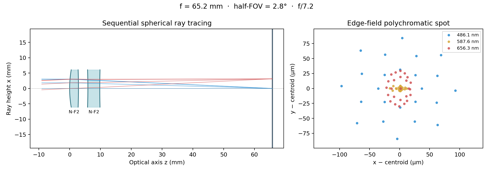
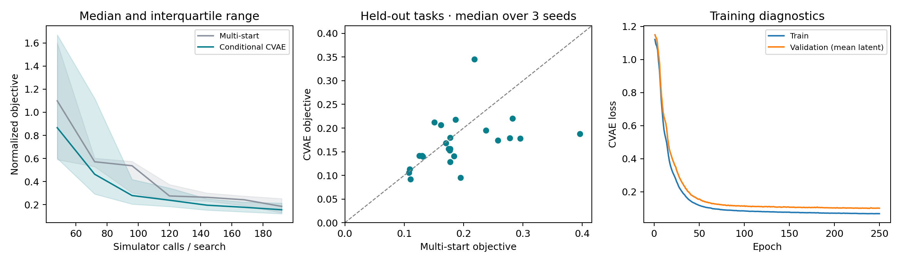
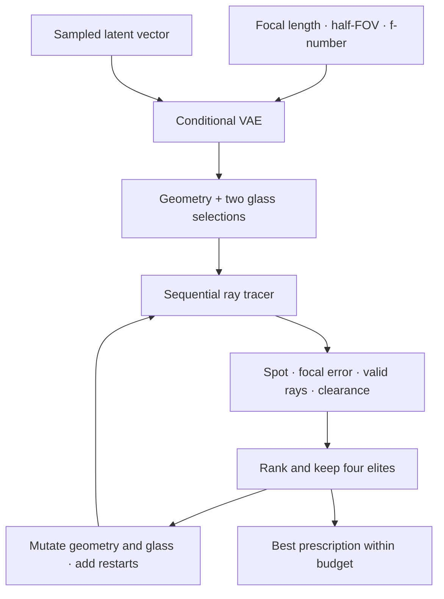

# Optical Design Agent

**Conditional generation, sequential ray tracing, and closed-loop optical optimization.**

A reproducible PyTorch experiment that proposes lens radii, element thicknesses, air gaps, sensor distance and glass choices for a fixed two-element imaging system. Requirements are effective focal length, field of view and f-number.



## Measured result

The repository includes **10,000 simulated designs**, a trained conditional variational autoencoder (CVAE), and a paired benchmark on **24 held-out tasks × 3 search seeds**.

| Online comparison | Multi-start search | CVAE-initialized search |
|---|---:|---:|
| Search evaluations per task and seed | 192 | 192 |
| Median objective, after per-task seed aggregation | 0.1772 | 0.1624 |
| Feasible runs, including dense ray audit | 100% | 100% |
| Median within-task standard deviation across seeds | 0.0482 | 0.0432 |

The median of paired task improvements is **11.39%**. Its task-bootstrap 95% interval is **−3.14% to 20.66%**, so this experiment does **not establish a statistically reliable advantage**. The ratio-of-medians improvement is 8.38%; these are different statistics. The model wins on 15 of 24 tasks by seed-median objective.

The proposed **27%** figure is **not supported by this run and is not claimed**. Full results, every prescription, individual seed outcomes, and simulator-call histories are in [the measured report](reports/results.md) and [raw benchmark JSON](reports/benchmark.json).



## Run a design in minutes

Python 3.10+; CPU is sufficient. From the repository root:

```bash
python -m venv .venv
source .venv/bin/activate  # Windows: .venv\Scripts\activate
python -m pip install torch --index-url https://download.pytorch.org/whl/cpu
python -m pip install -e '.[dev]'

optical-agent design --focal 50 --half-fov 5 --f-number 6 --budget 192
```

The included model is loaded with `torch.load(..., weights_only=True)`. The command writes a prescription with metrics to `reports/demo.json` and a ray/spot figure to `reports/demo.png`. `--half-fov 5` means a **10° full field of view**. All geometry is in millimetres; wavelengths are in micrometres internally.

To regenerate all evidence:

```bash
bash scripts/reproduce.sh
python -m pytest -q
```

Individual stages are also available:

```bash
optical-agent generate                       # 250 families × 40 variants
optical-agent train --epochs 250             # validation-selected checkpoint
optical-agent benchmark --tasks 24 --budget 192
optical-agent report
```

Exact floating-point values may vary with the PyTorch/NumPy version and hardware. Seeds, training history, environment versions and the fixed task list are recorded in the committed outputs. Reference execution: Python 3.12.14, NumPy 2.3.5, PyTorch 2.15.0+cpu (see JSON for authoritative versions).

## How it works



1. **Generate:** create 250 related prescription families with fixed family-level requirements. Each family has 40 geometry/material variants. Every one of the 10,000 designs is simulated, including poor and infeasible examples.
2. **Split by family:** 200 training families, 25 validation families, 25 test families. Related variants never cross splits. Select 24 test families with a fixed seed before evaluating the benchmark.
3. **Learn:** fit a CVAE on the best 20% of examples *within each training family*. The encoder consumes nine continuous genes, two one-hot glass IDs and three requirements. An 8-dimensional latent decoder predicts continuous geometry and categorical glass logits. Validation selects the checkpoint; test data never fit the model.
4. **Search:** draw 48 initial candidates, simulate, keep four elites, then refine in batches of 24 until exactly 192 design evaluations are used. Refinement includes geometry perturbations, material changes and uniform restarts. The baseline uses the **same refinement algorithm and budget**, with uniform initial proposals.
5. **Audit:** independently evaluate the selected prescriptions with a denser ray sample. Audit scores never feed back into optimization.

## Optical model and objective

The topology is a positive biconvex element followed by an air gap, a negative biconcave element, and a planar sensor. The stop is at the first surface vertex plane. The learned geometry also sets a common clear semi-diameter. Glasses are N-BK7, N-F2 and N-SF5, with Sellmeier dispersion.

The tracer uses exact ray–sphere intersections on the intended spherical cap, vector Snell refraction, total-internal-reflection rejection and forward propagation checks. It traces three fields (0, 0.7× and 1× half-FOV), three wavelengths (486.1, 587.6 and 656.3 nm), and 25 pupil points: **225 rays per search evaluation**. The dense audit uses **1,737 rays**.

The objective is dimensionless, with lower values better:

\[
J = \frac{R_{\mathrm{RMS}}}{0.01 f_t}
+5\frac{|f_{\mathrm{eff}}-f_t|}{f_t}
+10(1-T)
+2\frac{\max(0,0.5-c_{\min})}{0.01 f_t}
+10\mathbf{1}[f_{\mathrm{eff}}\leq0].
\]

`R_RMS` is the RMS over fields of the polychromatic RMS spot radius, using a shared colour centroid within each field. `T` is the fraction of valid sampled rays, and `c_min` is the minimum material/air clearance (mm). Effective focal length comes from an independent paraxial ABCD calculation. Designs with fewer than three surviving rays in a field receive a large spot penalty.

Feasibility requires positive focal length, ≤10% relative focal error, ≥0.5 mm clearance and ≥90% valid rays **in every field/wavelength**. These are experiment thresholds, not manufacturing specifications.

## Scope and limits

- This is a **synthetic inverse-design prototype**, not a validated optical CAD replacement. No commercial solver or physical measurements were used for cross-validation.
- Family separation prevents sibling leakage. All test requirements remain inside the same parameter distribution; this is not evidence of generalization to new optical topologies or materials.
- Both methods receive equal **online** simulator-call budgets. The CVAE additionally benefits from offline data and training; its offline cost is **not** charged to the online budget. The broad uniform baseline is limited; stronger baselines and a training-example retrieval control remain future work.
- The three search seeds measure proposal/refinement variability for **one trained model**. They do not quantify variation over data generation or model training.
- Geometric ray survival is not energy throughput. Diffraction, Fresnel losses, coatings, absorption, polarization, distortion penalties, decentration, fabrication tolerances, and thermal effects are omitted.
- The finite pupil quadrature and common clear aperture can miss vignetting or mechanical issues between sampled rays. The extra dense audit helps inspect this limitation; it is not a proof of manufacturability.
- With geometry scaled by target focal length, this experiment mainly tests normalized optical shape; the model's dependence on absolute focal length is limited. Aperture and field requirements provide the more meaningful conditioning challenge.

## Repository map

| Path | Contents |
|---|---|
| `src/optical_agent/physics.py` | Spherical tracing, Snell law, ABCD and optical metrics |
| `src/optical_agent/glass.py` | Three-glass Sellmeier catalog |
| `src/optical_agent/dataset.py` | Data generation, family splits and elite selection |
| `src/optical_agent/model.py` | PyTorch CVAE, training and proposal sampling |
| `src/optical_agent/search.py` | Equal-budget search and accounting |
| `src/optical_agent/benchmark.py` | Paired benchmark and dense audit |
| `data/designs.npz` / `.json` | 10,000 designs and family manifest |
| `models/cvae.pt` / `.json` | Trained weights and training history |
| `reports/` | Raw results, generated plots and experiment logs |
| `tests/` | Physical checks, split isolation, reproducibility and budget checks |
| `docs/physics.md` | Conventions, sources and parameter bounds |

MIT license. Author: Amer Saidi.
